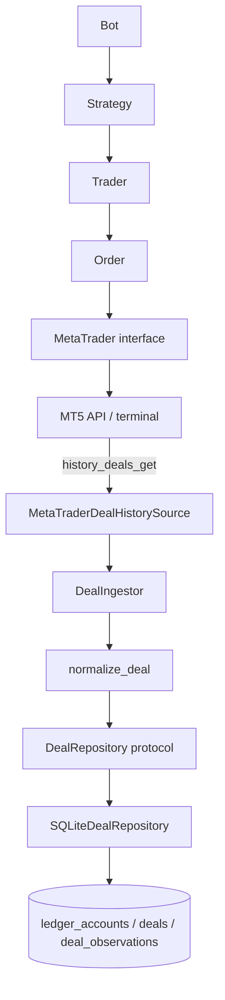

<p align="center">
  
</p>

<h1 align="center">owen-aiomql</h1>

<p align="center">
  <strong>Asynchronous Python Library for MetaTrader 5 and Algorithmic Trading</strong>
</p>

<p align="center">
  <a href="pyproject.toml">= 3.13"></a>
  <a href="LICENSE"></a>
  <a href="https://github.com/DQuooc/owen-aiomql/stargazers"></a>
  <a href="https://github.com/DQuooc/owen-aiomql/issues"></a>
</p>

## Overview

**owen-aiomql** provides an asynchronous interface to MetaTrader 5 and a framework for building algorithmic trading bots. It combines market-data access, reusable strategies, order execution, position management, trading sessions, and risk and money management.

The repository extends the upstream [aiomql](https://github.com/Ichinga-Samuel/aiomql) project. Its Python distribution and import package remain **`aiomql`**. Use the low-level MetaTrader interface directly, or compose symbols, traders, and strategies into a bot.

### Original AIOMQL foundation

Upstream AIOMQL supplies the asynchronous MetaTrader 5 interface and trading framework: bot and strategy execution, symbols and market data, orders and positions, sessions, risk and money management, position tracking, technical indicators, configuration, and CSV/JSON/SQLite trade-result recording. Those general trading APIs remain available here. The Deal Ledger below is a separate historical-deal store; it does not replace the existing trade-result recorder.

## Enhancements in This Repository

| Area | Status | What the current code provides |
| --- | --- | --- |
| Deal Ledger | Implemented | Account-scoped historical MT5 deals in a durable SQLite file, with raw payload and normalized fields. |
| Durable ledger checkpoint | Implemented | One SQLite checkpoint per registered account, monotonic advancement, idempotent same-boundary replay, and restart durability. |
| Recovery range planning | Implemented | Public `RecoveryRange` and pure `plan_recovery_range()` for explicit bootstrap or checkpoint overlap, with deterministic UTC planning and offline ingestion composability. |
| RecoveryManager | Implemented; offline verified | Read-only account preflight, checkpoint snapshot, `RecoveryConfig`, injected horizon clock, preparation and one-shot ingestion orchestration. `RecoveryResult` reports pending reconciliation or failure; no checkpoint advancement. |
| Deal ingestion | Implemented | Explicit, one-shot MT5 history fetch, UTC request bounds, account checks, per-deal persistence, and a structured report. |
| Replay and audit | Implemented | Insert/duplicate/conflict outcomes; changed payloads leave the original deal intact and create a deduplicated observation. |
| Repository integrity | Implemented | Re-normalizes and validates the raw payload and derived fields before classifying or writing a deal. |
| Order submission safeguards | Implemented | A final order check before native submission and explicit propagation of uncertain send outcomes without automatic resubmission. Open-position hedge/stack attempts also have an **in-memory**, per-object guard. |
| Offline tests | Implemented | Fake-SDK and temporary-SQLite tests for the ledger and execution safeguards; no terminal is needed. |
| Reconciliation and recovery completion | Not implemented | MT5-to-ledger comparison, recovery checkpoint advancement, same-account reconcile/advance coordination, automatic startup recovery, and live MT5 recovery validation remain future work. |

The ledger is invoked by application code; it is not wired into `Bot.execute()` as an automatic background service. Only `SQLiteDealRepository` implements the ledger repository contract today. The `DealRepository` protocol provides a boundary for a possible future storage backend, not a second implemented database.

## Key Features

- **MetaTrader 5 interfaces** — asynchronous terminal calls, plus `MetaTraderSync` and selected synchronous trading components.
- **Bot orchestration** — run strategies across instruments with thread-pool execution, coroutine tasks, and independent bots through `Bot.process_pool()`.
- **Reusable strategies** — implement `Strategy.trade()` with configurable parameters and a session-aware execution loop.
- **Market data** — retrieve symbol information, candles, ticks, market depth, and trading history.
- **Orders and positions** — check and send orders, estimate margin and profit, query positions, and close trades.
- **Risk and money management** — `RAM` provides risk amounts, risk-to-reward settings, and position-limit checks for use in trading logic.
- **Trading sessions and tracking** — schedule trading in UTC windows, track strategy state, and attach position callbacks such as profit exits and take-profit extensions.
- **Trade records** — save results to CSV, JSON, or SQLite; `aiomql.ledger` provides explicit deal-history ingestion and account-scoped SQLite storage.
- **Technical analysis** — pandas-backed candles expose bundled pandas-ta-classic indicators with optional TA-Lib support.
- **Configuration and extensions** — share JSON or programmatic settings through `Config`, and build on `ForexSymbol`, `SimpleTrader`, `ScalpTrader`, and other contrib components.

## Requirements

- **Python 3.13 or later**, as declared in `pyproject.toml`.
- **64-bit Windows** for the native `MetaTrader5` Python dependency; the repository lockfile contains Windows x86-64 wheels for it.
- A locally installed **MetaTrader 5 desktop terminal** and a broker trading account.
- Terminal permissions that allow Python trading when running order-execution examples.

See the official [MetaTrader 5 Python integration guide](https://www.mql5.com/en/docs/python_metatrader5) for terminal integration details.

## Installation

Install this repository from source in a virtual environment:

```powershell
git clone https://github.com/DQuooc/owen-aiomql.git
cd owen-aiomql
python -m venv .venv
.\.venv\Scripts\Activate.ps1
python -m pip install --upgrade pip
python -m pip install .
```

The installed distribution is named `aiomql`. Source installation selects the code in this repository.

Optional extras declared in `pyproject.toml` can be installed from the same checkout:

```powershell
# TA-Lib indicators
python -m pip install ".[talib]"

# Cython, Numba, and tqdm
python -m pip install ".[optional]"

# Both sets of optional dependencies
python -m pip install ".[all]"
```

## Quick Start

### Configuration

Create `aiomql.json` in the directory from which you run your application:

```json
{
  "login": 12345678,
  "password": "your_password",
  "server": "YourBroker-Demo"
}
```

Alternatively, configure the shared `Config` instance before constructing trading components:

```python
from aiomql import Config

config = Config(
    login=12345678,
    password="your_password",
    server="YourBroker-Demo",
)
```

Programmatic values override file settings. Set `path` to your terminal executable if needed, and use `root` or `config_file` to select a different configuration location. Keep account credentials out of version control.

### MetaTrader Interface

With configuration in place, use the asynchronous interface to read account and symbol information:

```python
import asyncio

from aiomql import MetaTrader


async def main():
    async with MetaTrader() as mt5:
        account = await mt5.account_info()
        if account is None:
            raise RuntimeError(f"Unable to read account information: {mt5.error}")
        print(account)

        symbols = await mt5.symbols_get()
        print(f"{len(symbols or ())} symbols available")


if __name__ == "__main__":
    asyncio.run(main())
```

The context manager initializes the terminal, attempts login using `Config`, and shuts down the connection on exit.

## Deal Ledger

`aiomql.ledger` records **historical MT5 deals**, one row per `(mt5_account_id, deal_ticket)`. An application supplies a stable, persisted `mt5_account_id` UUID and registers its `AccountRef` before ingestion. The repository binds that UUID to `(broker_namespace, server, login)`, rejects conflicting mappings, and scopes deal and observation reads by account. `broker_namespace` is supplied by the application; MT5 does not verify it.

`MetaTraderDealHistorySource` reads raw records through an injected async MetaTrader client. `DealIngestor.ingest_range()` requires timezone-aware bounds, converts the requested range to UTC, checks the current login/server before **and** after fetching, normalizes each record, and writes it through the repository. The source preserves SDK namedtuple/mapping fields, including unknown fields. Normalization creates a canonical raw JSON snapshot and hash alongside typed fields, including `Decimal` values and the original broker time/time-in-milliseconds. It stores the first observation time in UTC; it does not reinterpret broker deal timestamps as UTC datetimes.

The repository re-runs normalization from that raw snapshot and validates the normalized values, types, account ID, deterministic deal ID, hash, and normalizer version before any write or replay decision. This guards the ledger against inconsistent `NormalizedDeal` objects passed directly to the repository.

| Same account and deal ticket | `ingest()` outcome | Stored result |
| --- | --- | --- |
| New ticket | `INSERTED` | Insert the deal and its original raw payload. |
| Existing ticket, same canonical payload | `DUPLICATE` | Keep the original row; add nothing. |
| Existing ticket, changed canonical payload | `CONFLICT` | Keep the original row; store the changed raw payload as a `DealObservation`, once per distinct payload hash. |

Tickets are unique **within an MT5 account**, so the same ticket can exist in different accounts. Distinct deal tickets sharing an order ticket or position ID are stored independently, including partial fills. Order and position tickets are indexed lookup fields, not unique ledger records.

Each ingestion call returns an `IngestionReport` with `retrieved`, `normalized`, `inserted`, `duplicates`, `conflicts`, `invalid`, and stage-specific errors:

| Status | Meaning |
| --- | --- |
| `SUCCESS` | A non-empty batch was processed without errors; duplicate and conflict outcomes can still be present. |
| `SUCCESS_EMPTY` | The source returned an empty deal batch after both account checks. |
| `PARTIAL` | Some records failed normalization, while at least one record was normalized and classified by storage. |
| `FAILED` | An account/fetch/storage failure occurred, or every fetched record was invalid. |

Writes commit per deal, rather than as one whole-batch transaction. A later storage failure or cancellation can leave earlier deals committed; the report preserves completed counters on storage failure, while cancellation propagates to the caller. Replaying a range is safe for identical deals because of the account/ticket uniqueness rule, but ingestion does not automatically retry or advance a checkpoint. The before/after account checks cannot detect an account switch that changes away and back during the fetch.

`LedgerCheckpoint` stores an account UUID, an inclusive `completed_through` boundary, and a repository-generated `updated_at`. The independent `CheckpointRepository` protocol is implemented by `SQLiteDealRepository`: callers explicitly advance a registered account's checkpoint through a boundary they have verified. Timestamps must be timezone-aware and are normalized to UTC with microseconds preserved. Advancement is transactional and monotonic; equal boundaries return the existing checkpoint without changing its audit time, and earlier boundaries raise `CheckpointRegressionError`. Checkpoints survive repository reopen and process restart. No checkpoint is inferred from stored deals, and checkpoint writes do not register accounts or update their metadata. Reads return `None` for a registered account without a checkpoint and raise `AccountIdentityError` for an unknown account.

`plan_recovery_range()` returns an immutable `RecoveryRange` using explicit `current_time` and non-negative `overlap`. With a checkpoint, it plans from `completed_through - overlap` through `current_time` and ignores `bootstrap_start`. Without a checkpoint, it requires an explicit `bootstrap_start`; overlap is validated but does not shift that start. Inputs must be timezone-aware; output is canonical UTC with microseconds preserved, and equal endpoints are valid. Future boundaries and invalid inputs fail explicitly. Offline tests verify direct composition with `DealIngestor.ingest_range()` using fake sources and temporary SQLite. The planner performs no I/O and never advances checkpoints; ingestion success alone does not establish recovery completion.

`RecoveryManager.prepare()` verifies the registered broker/server/login-to-UUID mapping without registration or metadata updates, loads and validates the account's checkpoint, captures its injected `Clock` exactly once, and calls the planner. Its immutable `RecoveryAttempt` contains the account, checkpoint snapshot, and planned range. Immutable `RecoveryConfig` supplies non-negative overlap and an optional explicit bootstrap start; provided timestamps are canonicalized to UTC with microseconds preserved. The manager reads no horizon clock before identity/checkpoint validation succeeds.

`RecoveryManager.recover()` reuses preparation and passes the exact account/range to `DealIngestor`. Ingestion `SUCCESS` or `SUCCESS_EMPTY` produces `RecoveryOutcome.PENDING_RECONCILIATION`; `FAILED` or `PARTIAL` produces `FAILED`. Successful ingestion does not mean completed recovery. The immutable `RecoveryResult` preserves the returned report and preparation snapshot, with `checkpoint_after = checkpoint_before`. The manager never creates or advances checkpoints, including on empty history or conflicts. Preparation errors, unexpected ingestion exceptions, and cancellation propagate; earlier per-deal commits remain. Retry requires a later caller invocation, which reloads the durable checkpoint and captures a new horizon.

Offline tests cover failures, cancellation, partial persistence, replay/idempotency, and account isolation. Same-account concurrency is **CONDITIONALLY SAFE** only for this ingestion-only/no-advance stage with correctly bound dependencies. Checkpoint monotonicity does not serialize fetch, ingestion, future reconciliation, and advancement; that future flow needs explicit coordination. Offline concurrency evidence does not establish live multi-account MT5 session safety, and before/after guards cannot detect an A -> B -> A switch during fetch. See the [offline concurrency boundary](tests/offline/README.md#recoverymanager-concurrency-boundary-a39).

The ledger requires a file-backed SQLite path and an explicitly registered account. See the [ledger source](src/aiomql/ledger/) and [offline tests](tests/offline/) for the API contracts. Run the offline suite below to work on ingestion without a terminal.

## Building a Trading Bot

### 1. Define a Strategy

Subclass `Strategy` and implement one trading iteration in `trade()`. The framework calls it repeatedly while the strategy is running and checks its sessions before each iteration. Entries in `parameters` are accessible as attributes and can be overridden with `params`.

Save this example as `ema_crossover.py`. It checks the last two completed candles for an EMA crossover and delegates execution to `ScalpTrader`:

```python
from aiomql import (
    ForexSymbol, OrderType, ScalpTrader, Sessions, Strategy, TimeFrame, Tracker,
)


class EMAXOver(Strategy):
    parameters = {
        "timeframe": TimeFrame.H1,
        "count": 200,
        "fast_ema": 20,
        "slow_ema": 50,
        "interval": TimeFrame.M15,
    }

    def __init__(self, *, symbol: ForexSymbol, params=None, sessions: Sessions = None):
        super().__init__(symbol=symbol, params=params, sessions=sessions)
        self.trader = ScalpTrader(symbol=symbol)
        self.tracker = Tracker(snooze=self.interval.seconds)

    async def trade(self):
        candles = await self.symbol.copy_rates_from_pos(
            timeframe=self.timeframe, count=self.count, start_position=1,
        )
        if len(candles) < max(self.fast_ema, self.slow_ema) + 2:
            await self.sleep(secs=self.interval.seconds)
            return

        fast = candles.ta.ema(length=self.fast_ema, talib=False)
        slow = candles.ta.ema(length=self.slow_ema, talib=False)
        direction = None
        if fast.iloc[-2] <= slow.iloc[-2] and fast.iloc[-1] > slow.iloc[-1]:
            direction = OrderType.BUY
        elif fast.iloc[-2] >= slow.iloc[-2] and fast.iloc[-1] < slow.iloc[-1]:
            direction = OrderType.SELL
        self.tracker.update(order_type=direction)

        if self.tracker.order_type is None:
            await self.sleep(secs=self.interval.seconds)
            return

        await self.trader.place_trade(
            order_type=self.tracker.order_type, parameters=self.parameters,
        )
        await self.delay(secs=self.timeframe.seconds)
```

This example uses the bundled EMA implementation without requiring TA-Lib. `ScalpTrader` defaults to the symbol's minimum volume and places orders without stop-loss or take-profit levels. Use a demo account for the tutorial; adapt execution and position management before applying your own trading rules. `SimpleTrader` accepts a stop-loss price, and custom `Trader` subclasses can use `RAM` for sizing.

### 2. Run the Strategy with a Bot

Save this as `bot.py` alongside `ema_crossover.py`. Use your broker's exact symbol names:

```python
import logging

from aiomql import Bot, ForexSymbol
from ema_crossover import EMAXOver


def main():
    logging.basicConfig(level=logging.INFO)
    symbols = [ForexSymbol(name=name) for name in ("EURUSD", "GBPUSD", "USDJPY")]
    strategies = [EMAXOver(symbol=symbol) for symbol in symbols]

    bot = Bot()
    bot.add_strategies(strategies=strategies)
    bot.execute()


if __name__ == "__main__":
    main()
```

Run it with `python bot.py`. `Bot.execute()` initializes the terminal and symbols, then runs the registered strategies through its executor until shutdown.

To run an optional position tracker, register its coroutine before `bot.execute()`:

```python
from aiomql import OpenPositionsTracker

tracker = OpenPositionsTracker(autocommit=True)
bot.add_coroutine(coroutine=tracker.track, on_separate_thread=True)
```

The tracker processes `OpenPosition` objects registered in shared state; starting it alone does not attach tracking rules to every account position. See the [tracking APIs](docs/contrib/trackers/open_position.md) for registration and callbacks.

`await bot.start()` is also available for asynchronous initialization. It calls the same blocking executor afterward, so it occupies the calling event loop while the bot runs.

## Trading Sessions

Pass `Sessions` to a strategy to limit trading to selected windows. Session checks use **UTC**; the labels below are illustrative fixed windows and do not adjust for daylight saving time.

```python
from datetime import time

from aiomql import ForexSymbol, Session, Sessions
from ema_crossover import EMAXOver

london = Session(name="London", start=time(8, 0), end=time(16, 0))
new_york = Session(name="New York", start=time(13, 0), end=time(21, 0))
sessions = Sessions(sessions=[london, new_york])

strategy = EMAXOver(symbol=ForexSymbol(name="EURUSD"), sessions=sessions)
```

Sessions can also run configured start/end actions, including custom callbacks. See the [session reference](docs/lib/sessions.md) for details.

## Concurrent and Multi-process Execution

Within a bot, the executor runs strategies in worker threads, each asynchronous strategy using its own event loop. `Bot.add_coroutine()` and `Bot.add_function()` register additional work.

For independent bots, `Bot.process_pool()` maps module-level callables to keyword-argument dictionaries. Keep the process-pool call inside a main guard on Windows:

```python
from aiomql import Bot, ForexSymbol
from ema_crossover import EMAXOver


def run_bot(*, symbol_name: str):
    bot = Bot()
    bot.add_strategy(strategy=EMAXOver(symbol=ForexSymbol(name=symbol_name)))
    bot.execute()


def run_forex():
    run_bot(symbol_name="EURUSD")


def run_crypto():
    run_bot(symbol_name="BTCUSD")


if __name__ == "__main__":
    Bot.process_pool(
        processes={run_forex: {}, run_crypto: {}},
        num_workers=2,
    )
```

Each process initializes its own configuration and terminal connection. This helper schedules processes; configure account and terminal settings inside each worker when they differ.

## Project Structure

```text
src/aiomql/
├── __init__.py            # Public core, lib, contrib, and utility exports
├── core/                  # Terminal integration and shared infrastructure
│   ├── config.py          # JSON and programmatic configuration
│   ├── meta_trader.py     # Asynchronous MetaTrader interface
│   ├── volume.py          # Volume validation and rounding
│   ├── db.py              # SQLite persistence helpers
│   └── sync/              # Synchronous MetaTrader interface
├── lib/                   # Trading framework
│   ├── bot.py             # Bot startup and process pool
│   ├── executor.py        # Thread and coroutine execution
│   ├── strategy.py        # Strategy lifecycle and trade loop
│   ├── symbol.py          # Instruments and market data
│   ├── candle.py          # Candles and indicator access
│   ├── order.py           # Order checks and submission
│   ├── trader.py          # Execution and sizing helpers
│   ├── positions.py       # Position queries and closing
│   ├── ram.py             # Risk and money management
│   ├── sessions.py        # Session windows and actions
│   ├── result.py          # CSV, JSON, and SQLite result recording
│   └── sync/              # Selected synchronous trading components
├── contrib/               # Strategies, symbols, traders, and trackers
├── ledger/                # Historical-deal source, normalization, ingestion,
│                          # repository contract, and SQLite implementation
├── ta_libs/               # Bundled pandas-ta-classic implementation
└── utils/                 # Decorators, price helpers, and process pools
```

### Execution and ledger flow



The trading path and history-ingestion path are separate. Application code constructs the source and ingestor and calls `ingest_range()` explicitly; the diagram does not imply that a bot automatically ingests its trades.

## Roadmap / Work in Progress

The following recovery and engine capabilities are **not implemented**:

- Same-account reconciliation/advancement coordination, automatic startup recovery, and live MT5 recovery validation. Current RecoveryManager support ends at pending reconciliation or failure.
- Automatic checkpoint advancement after recovery or ingestion.
- MT5 ↔ Deal Ledger reconciliation, including missing or inconsistent deal detection.
- Evaluation of PostgreSQL as a possible production ledger backend. There is no PostgreSQL, MySQL, or SQL Server ledger implementation in this repository.
- Local Engine entrypoint, packaging/`.exe`, and EA bridge.

## API Documentation

Start with the [API Reference](docs/toc.md) for core, trading, contrib, and utility modules. The [tutorial](docs/tutorial.md), [examples](examples/), and [execution-flow overview](docs/code-reading/01-execution-flow-overview.md) provide additional usage and architecture context. Check source signatures when adapting examples.

## Testing

The repository separates offline execution/ledger tests from terminal-connected pytest tests.

### Offline Tests

From the repository root, run the standard-library suite with fake SDK dependencies:

```powershell
python -B -m unittest discover -s tests/offline -p 'test_*.py' -v
```

This command limits discovery to `tests/offline` and avoids the live pytest fixtures. See the [offline test guide](tests/offline/README.md).

The ledger tests cover successful and empty ingestion, invalid records and fetch responses, account mismatch before/after fetch, account isolation, identical replay, changed-payload observations, partial fills sharing an order/position, storage failures, UTC request conversion and boundary records, cancellation propagation, and repository re-validation of raw payload and derived fields. They use fake history sources and temporary SQLite files.

### Terminal-connected Tests

Development dependencies, including `pytest` and `pytest-asyncio`, are declared in the `dev` dependency group. From the repository root, install the project in editable mode and install that group with [pip 25.1 or later](https://pip.pypa.io/en/stable/user_guide/#dependency-groups):

```powershell
python -m pip install -e .
python -m pip install --group dev
```

Configure `aiomql.json` and a MetaTrader 5 terminal connected to a dedicated demo account before running:

```powershell
python -m pytest -c tests/pytest.ini tests/live
```

**Live tests can place trades, and their cleanup closes all open positions on the connected account.** Review `tests/live/conftest.py` before running them. Unrestricted `pytest tests` also discovers these fixtures.

## Contributing

Contributions, bug reports, documentation improvements, and pull requests are welcome. For significant changes, please open an [issue](https://github.com/DQuooc/owen-aiomql/issues) first to discuss the proposed direction.

Submit contributions to [DQuooc/owen-aiomql](https://github.com/DQuooc/owen-aiomql) and follow the [Code of Conduct](CODE_OF_CONDUCT.md). This project builds on aiomql by Ichinga Samuel; upstream attribution and copyright are retained in the [license](LICENSE).

## License

[MIT](LICENSE)
